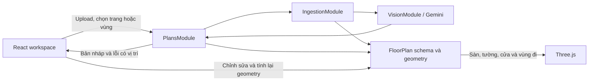

# 03. Kiến trúc và cấu trúc repo

[Mục lục](README.md)

## 3.1. Stack

| Thành phần | Lựa chọn | Trách nhiệm |
| --- | --- | --- |
| Web | React, Vite, TypeScript | Chọn tài liệu, đối chiếu 2D, chỉnh bản nháp và điều khiển viewer. |
| Viewer | Three.js | Dựng mesh từ dữ liệu đã kiểm tra, hiển thị và điều khiển camera. |
| API | NestJS, TypeScript, HTTP adapter mặc định | Nhận upload, điều phối phân tích, xác thực bản nháp và trả lỗi có cấu trúc. |
| PDF | PDF.js | Đọc text và toán tử đồ họa, render trang, lấy thông tin viewport. Khả năng chạy render trong Node của bộ phụ thuộc đã chọn cần được xác minh sớm. |
| AI | Google Gen AI SDK `@google/genai` | Đọc ảnh và diễn giải vùng khó, trả dữ liệu có cấu trúc. |
| Miền nghiệp vụ | TypeScript, Zod | Schema, chuẩn hoá tọa độ, kiểm tra hình học, cắt cửa và vùng đi lại. |
| Build và runtime | npm workspaces, Docker, Cloud Run | Một repo, một lockfile, một image chứa API và frontend đã build. |

P0 xử lý trực tiếp và giữ bản nháp trong phiên trình duyệt. P1 bổ sung lưu bản đã duyệt ở nơi lưu trữ bền vững. Docker và Cloud Run nằm trong thiết kế từ đầu. [Deploy](07-deployment.md) · [NestJS Modules](https://docs.nestjs.com/modules) · [PDF.js API](https://mozilla.github.io/pdf.js/api/draft/module-pdfjsLib-PDFPageProxy.html)

## 3.2. Cây thư mục dự kiến

```text
apps/
  api/
    src/
      main.ts
      app.module.ts
      plans/               Controller, DTO, phân tích và kiểm tra bản nháp
      ingestion/           Đọc PDF, ảnh và chuẩn hoá nguồn
      vision/              Cấu hình, adapter và schema trả về của Gemini
      health/              Trạng thái tiến trình
  web/
    src/
      features/
        plan-workspace/    Upload, overlay 2D, chỉnh sửa và trạng thái bản nháp
        walkthrough/       Scene Three.js, camera, điều khiển đi bộ
      api/                 Client HTTP và ánh xạ lỗi
packages/
  floorplan/
    src/
      schema/              FloorPlanV1 và kết quả kiểm tra
      geometry/            Phòng, tường, cửa, mesh inputs và collision
    test/                  Test các quy tắc hình học
tests/
  fixtures/                Nguồn mẫu có quyền dùng và đáp án đã kiểm
  e2e/                     Luồng trình duyệt và Docker/Cloud Run
docs/
```

## 3.3. Ranh giới và chiều phụ thuộc

- **`PlansModule`** nhận HTTP và điều phối use case phân tích. Controller chỉ đọc request và chuyển kết quả thành HTTP. Quy tắc xử lý tài liệu ở service.
- **`IngestionModule`** chuyển tệp thành dữ liệu nguồn chung gồm kích thước vùng, phép đổi tọa độ, ảnh xem trước và bằng chứng text/vector nếu có. Bộ đọc PDF và ảnh dùng chung hợp đồng đầu ra.
- **`VisionModule`** cung cấp adapter Gemini qua một interface nội bộ của API. Có thể thay bằng stub trong test HTTP. Giữ response của nhà cung cấp trong module này và ánh xạ sang kiểu ứng viên dùng trong pipeline.
- **`packages/floorplan`** cung cấp schema và hàm TypeScript thuần cho API và web. Package độc lập với NestJS, React, SDK Google và Three.js. Viewer dùng các mảnh tường, polygon sàn và vùng đi lại do package tính.
- **Web** giữ một bản nháp có phiên bản chỉnh sửa và một lựa chọn đang hoạt động. Overlay và viewer cùng đọc bản nháp đó. Kết quả request cũ bị bỏ nếu nguồn hoặc revision đã đổi.



Tách module theo trách nhiệm của luồng hiện tại. Phần lưu trữ, worker và hàng đợi có thể thêm khi xuất hiện yêu cầu lưu bản, xử lý dài hoặc nhiều tài liệu đồng thời. [Pipeline và API](04-plan-pipeline.md)
